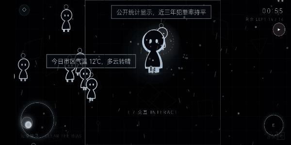

# Whitype-Project1-aXiz

由HTML5制作 小关卡游戏
该游戏具备相当的难度，需要玩家根据提示剧情自行推测通关条件

🎮 **在线试玩**：[https://acusiris.github.io/aXiz/aXiz.html](https://acusiris.github.io/aXiz/aXiz.html)

## 游戏简介

毫无征兆地，你从空旷的世界醒来————
这里是镜像地球，充满能量的·乃至喧嚣的地球。
你渴望回到原来的地球...
你需要收集足够的能量，但不正的能量或许会造成badend...
但是，真的只有收集那么简单吗？

## 玩法

- 使用上下左右按键控制移动
- 按E键交互
- 目标是推测通关规则并打到结局

## 游戏演示

## 运行方式

下载本仓库后，直接用浏览器打开 `aXiz.html` 即可游玩。
如果是希望在手机游玩，则下载 `aXiz-v3.3.8-android.apk` 即可游玩。

## 项目结构

- `aXiz.html` — html文件
- `aXiz-v3.3.8-android.apk` — apk文件
- `strategy.md` — 通关攻略

## 作者与鸣谢

Acusiris 主负责人 想法，故事，制作，美化，管理宣传
Jesse 制作辅助，交流与建议者
ds 制作框架主要辅助工具
鸣谢
道法实践作业主题 方向规定与想法落地契机
还有学校的电.......
